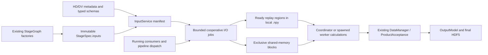
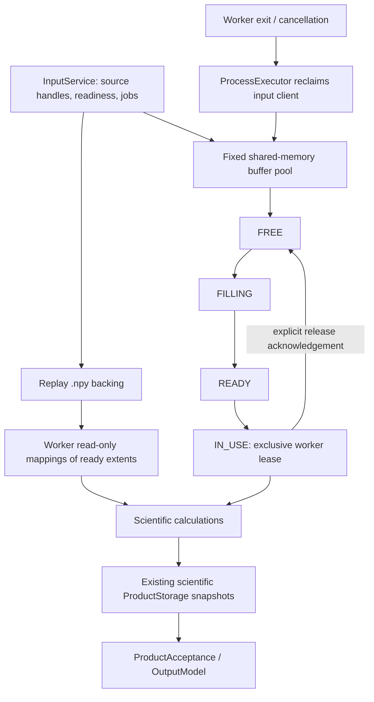

# Declarative HDF5 inputs, progressive replay and streaming

Implemented against `dev` at `d0568967`. Scientific execution, product acceptance,
output transactions and calculation axes are unchanged. The coordinator owns one
`InputService` and the read-only HD/DV handles for the acquisition.

## Data flow



Runtime reuses the graphs built for product registration. `configure(graphs,
run_settings)` resolves HD aliases, numeric band ordering, optional spectra and
DV fields through their typed schemas. It never runs scientific callbacks or
loads videos. The manifest records canonical identities, shape/dtype/chunks and
compression, consumers, optionality, access requirements and strategy. Absent or
malformed candidates appear in `unresolved`; stages retain their existing branch
validation, fallbacks and independent failure semantics. Missing HD/DV optional
segmentation fields remain optional. Dynamic band selection uses the existing
frequency-bound resolver, including its shape/type validation.
Native dataset handles remain open across slabs so their configured HDF5 raw
chunk caches survive; reopening a dataset for each slab would defeat that reuse.

`activate(pipeline)` starts a bounded first window at actual dispatch. Demand
promotes work ahead of speculation. Reading a velocity slice queues its partner's
current window before the next paired window. Only the selected velocity methods
get required declarations; topology separately records optional fallback candidates
without eagerly reading them. Undeclared consumers retain safe replay, with one
development diagnostic per canonical source identity.

## Input contract

```python
from pipeline_engine.stage_graph import InputAccess, InputUse, StageSpec

StageSpec("estimates", calculate, inputs=(
    InputUse("hd.moment0", InputAccess.SEQUENTIAL, when="doppler_moments"),
    InputUse("hd.moment2", InputAccess.SEQUENTIAL, when="doppler_moments"),
    InputUse("hd.band_low", InputAccess.SEQUENTIAL, when="frequency_bands"),
    InputUse("hd.band_high", InputAccess.SEQUENTIAL, when="frequency_bands"),
))
```

`InputUse` is frozen and its `access` field uses `InputAccess.METADATA`,
`InputAccess.SMALL`, `InputAccess.SEQUENTIAL`, `InputAccess.STREAM`, or
`InputAccess.RANDOM`. `when` supports the two existing scientific methods, resolved from
`selected_velocity_methods`; it is not an expression language. Access describes
the consumer. InputService chooses physical replay or streaming. Metadata-only
declarations perform no staging. A single stream consumer uses streaming; mixed
random/sequential requirements or multiple stream consumers select replay.

Worker APIs:

```python
chunk = dataset.read_slice(np.s_[32:64])  # immutable, ready extent only
chunk = dataset[32:64]                  # same semantics
array = np.asarray(dataset)            # waits for complete replay
dataset.read_direct(destination, source_sel=np.s_[32:64])

with dataset.iter_blocks(frames=16, writable=True) as blocks:
    for lease in blocks:
        with lease as block:
            process_in_place(block)
```

Streaming requires the outer context manager when early exit or exceptions are
possible. Blocks and their views must not escape their lease. Release the current
lease before advancing. `max_bytes=` bounds block size; omitted `frames` uses the
service policy. The final block has its actual remaining frame count. Explicit
`writable=True` permits in-place scientific work on exclusive working storage.
The source is never changed. Read-only leases express consumer intent; safety
comes from the protocol's refusal to recycle an owned buffer.

Basic integer/contiguous positive first-axis slices use region readiness,
including negative bounds and additional basic spatial selections. Empty slices
read no source values. Reverse/stepped, Boolean/advanced, leading-newaxis,
ellipsis and other indexing forms conservatively wait for full replay and use
NumPy indexing. Advanced indexing retains NumPy's independent writable-copy
behavior. `read_direct` copies completed replay values into the caller's owned
destination; source-to-replay and source-to-stream transfers use HDF5
`read_direct()` without an intermediate full-sized array.

## Ownership and readiness



Replay region states are `not_requested`, `queued`, `loading`, `ready`, and
`failed`. Discarded speculative jobs return to `not_requested`. Source reads
write disjoint first-axis regions and flush before publishing readiness. Ready
regions are never rewritten. Workers map only the requested completed extent:
following an ndarray's `.base` cannot expose uninitialized parts of the file.
Full `ArrayReference` publication requires every region ready. Hard-link aliases
share a canonical replay and readiness table. A failed region never becomes
ready or publishes a complete reference; already returned completed regions stay
valid. Other missing regions report the failure.

Every stream has a fixed pool. Control queues carry names, extents and release
messages, never video arrays. Filling and leasing are mutually exclusive; the
producer can fill a future block while the consumer partitions the current one.
Read errors propagate to the consumer and close its stream. Mixed-access streams
copy only completed replay extents into leased working buffers, avoiding source
rereads and isolating in-place mutations. Streams cancelled while a read is
running close at that bounded read boundary. Worker reaping reclaims abandoned
buffers/reservations, including forced termination on Windows spawn.

InputService owns replay backings separately from scientific products. It uses
the run's ProductStorage directory for local placement, not DataManager's product
acceptance. Scientific snapshots remain governed by existing ownership rules.
Runtime closes/reaps workers and closes client mappings before stopping the
reader and removing replay files, then closes the source handles. Unfinished
files are removed too. An abrupt coordinator kill cannot run Python cleanup;
normal run teardown, stream exceptions and worker crashes are covered.

## Bounds and scheduling

`InputPolicy` centralizes provisional defaults:

| Setting | Default |
|---|---:|
| Replay window | 32 frames |
| Streaming window | 16 frames |
| Buffers per stream | 2 |
| Ordinary source I/O target | 64 MiB |
| Active streams | 2 |
| Queued speculative replay jobs | 16 |
| Paired lookahead | One following window |

An individual frame may exceed the byte target. Frames are otherwise reduced to
fit it. Streaming reserves its buffers once in the existing `input` memory
account; reservations are released on close/reaping. If capacity is tight it
falls back to one buffer, then smaller frame counts, and fails explicitly if one
frame cannot fit. Replay reserves its active write window; speculative reads
decline under memory pressure. Required unadmittable reads report an error rather
than waiting indefinitely while the calculation owns a resource reservation.
Mapping pages and HDF5/OS caches are system-managed, not an application RAM cap.
This subsystem does not bound all downstream scientific allocations.

One source operation executes at a time. The service drains bounded request
traffic between operations; urgent work has priority 0, current lookahead 1,
dispatched pipeline prefetch 2 and opportunistic prefetch 3. Full conversions
queue one missing region at a time. Stale lookahead is discarded; speculation has
a separate queue bound. `cancel_prefetch()` removes only speculative jobs,
preserving urgent jobs and completed data. A single native HDF5 read is not
interruptible; priority takes effect at its next boundary. The scientific
CoordinatorScheduler has no new scheduling path.

## Diagnostics and validation

Existing `Logger.log_perf` filtering controls detailed diagnostics. Ordinary
frozen executable output does not acquire performance logs. Metrics include
metadata/manifest durations, queue/read/flush/wait times, logical read and replay
bytes, region hit/miss/reuse, first-ready latency, priority changes, unused
prefetch, buffer peaks, capacity reductions, completion/cancellation/failures and
worker cleanup. Existing callback/acquisition timings remain. Timestamped I/O
and callback intervals calculate overlap from interval unions, excluding that
consumer's input waits; simultaneous callbacks are not double counted. HDF5
logical bytes are not physical disk or NAS wire bytes.
Diagnostic interval histories are bounded to 8,192 entries each. If an unusually
long run exceeds that coverage, `input_overlap_valid=0` and a drop counter replace
the overlap result; aggregate read/wait/byte counters remain complete.

Numerical regression retains native HD axes, gap support, NaN/Inf policy,
float64 mean accumulation, frequency order, median partition semantics, velocity
units and calibration provenance.
All partition futures finish before any lease can be released after a failure.
