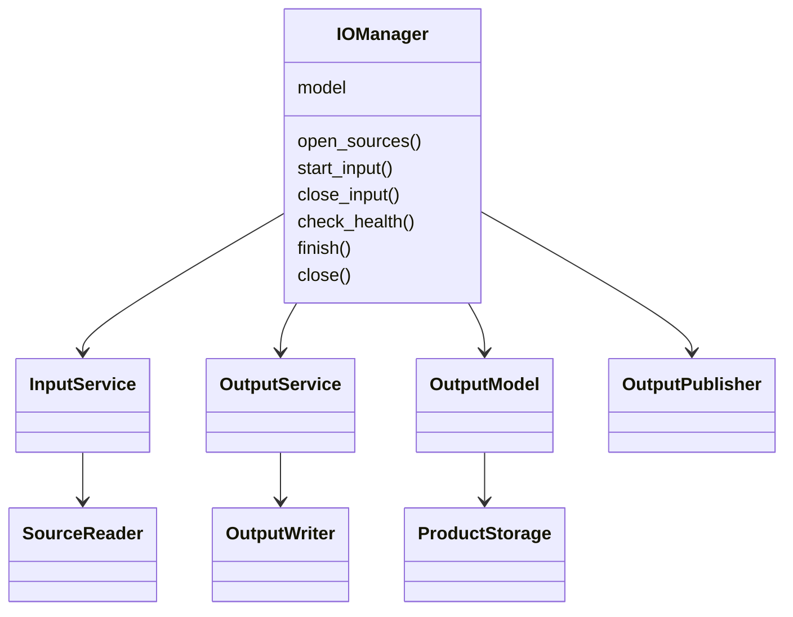

# Acquisition I/O runtime

`pipeline_engine/io` owns when runtime I/O happens and its resource lifetime.
`input_output` owns external schemas, paths, encodings and destination publication
policy. Scientific pipelines keep using `ctx.output.h5` and accepted managed data.

Previously, accepted records accumulated until scientific execution ended; one
terminal traversal serialized the entire model before destination publication.


## Components and ownership



| Owner | Responsibility |
|---|---|
| Scientific/coordinator workers | Build numerical products and commit through existing checkpoints/acceptance |
| `OutputModel` / `ProductAcceptance` | Authoritative immutable scientific records, metadata ownership, rollback, product visibility |
| Input control thread | Existing readiness, prefetch priorities, requests, leases and reservations |
| Input source thread | Existing single HDF5 read lane and exclusively owned destinations |
| Output delivery thread | Bounded command manifests, writer admission, acknowledgements, errors and counters |
| Output writer process | Exclusive incomplete primary HDF5 handle, accepted dataset serialization, final metadata/inventory verification |
| `IOManager` | Acquisition services, raw input handles, retained output/artifact lifetime and final publication |
| `OutputPublisher` | Copy a completed closed local file to a hidden destination name, then atomically replace |

The stable input implementation moved mechanically from `data/input_*` to
`io/input/{service,source_reader,replay,location}.py`. Its scheduling, public modes,
replay/stream limits and zero-RPC authorization behavior are unchanged. Generic
storage, transfer and calculation scratch remain under `data`.

`output/finalization.py` and its `PendingOutput` wrapper were removed. The manager
is itself the retained finalization handle used by the existing batch scheduler.
The terminal full-model serialization loop was removed from `h5_publication.py`.
Standalone `OutputModel.publish()` uses the same writer and publication components.

| Implementation | Change |
|---|---|
| `io/manager.py` | Retained acquisition lifecycle, input close, artifact/status reconciliation and publication |
| `io/output/service.py` | Accepted-ledger delivery, bounded backlog, resource admission, completion/error handling |
| `io/output/writer.py`, `protocol.py` | Spawned exclusive writer, sequence/inventory checks and child-owned IPC connections |
| `io/input/` | Mechanical relocation of the four stable input modules and their imports |
| `output/output_model.py` | Safe post-commit observer; standalone publication uses the same output service |
| `execution/runtime.py`, `run_service.py` | Manager setup, health/progress, retained batch handoff; existing DAG/batch scheduling preserved |
| `execution/worker.py`, `data/transfer.py` | Updated input namespace imports |
| `input_output/writers/h5_publication.py` | Reused record/attribute encoding and independent atomic publisher |
| Output/input/acceptance tests | New writer/fault tests, safe-commit tests, and updated moved-owner patch paths |

## The accepted-record boundary

```mermaid
sequenceDiagram
    participant S as Scientific stage / worker
    participant M as OutputModel and ProductAcceptance
    participant D as OutputService delivery
    participant W as Spawned HDF5 writer
    S->>M: Stage handoff / worker commit
    M->>M: Validate and commit existing transaction
    M->>M: Remove all enclosing rollback masks for irrevocable paths
    M->>D: Post-commit observer, safe committed snapshot
    D->>D: Bounded manifest + monotonic sequence
    D->>W: Filename, checksum and sequence
    W->>W: Reopen immutable backing; write and flush accepted datasets
    W-->>D: Matching completion and written paths
    S->>S: Later calculations continue
```

A `Record.committed` flag alone is insufficient: an enclosing checkpoint can
still roll back a nested commit. The model observer uses `committed_delta()`,
which reverses every remaining checkpoint mask. Stage handoff advances all active
checkpoints, making those paths irrevocable before later work in the invocation.
This covers non-exposed handoffs as well as worker acceptance, initialization and
legacy invocation results. Rejected merge/artifact/state transactions never enter
the writer. Worker transport receipts retain their separate existing meaning.

Observers cannot throw an I/O failure back through an already accepted scientific
transaction. A terminal materialization error is retained and reported at runtime
health checks or finalization, which prevents physical publication. Scientific
failure can still publish valid earlier accepted results and accurate statuses.

The service advances submission state only after successfully queuing a manifest.
When capacity is full, remaining accepted records stay in the authoritative model
ledger; there is no second unbounded payload queue. Subsequent safe notifications,
coordinator progress and final draining resume delivery. This keeps the coordinator
free to reap workers even if their CPU reservations currently prevent writer
admission. Finalization always revisits the ledger, so a missed notification cannot
lose an accepted record.

Sequences are monotonic per service. The writer rejects gaps/conflicts, acknowledges
identical repeated commands without recreating datasets, and rejects changes to
an existing scientific dataset. Mutable group/root metadata is reconciled once at
the end, including deletion of stale keys and replacement attribute dtypes. Final
inventory validation uses logical scientific paths: encoding-owned private VDS
backing datasets are allowed. No scientific dataset is rewritten at finalization.

## Backing, resources and cancellation

Large payloads remain in their existing immutable `.npy` or private HDF5 backing.
Numeric payloads are not transported through multiprocessing queues. Commands
carry only a manifest identity/checksum; accepted records are batched up to 32 per
manifest. Smaller resident values and metadata are serialized in those manifests.
Writer mappings close after each operation. An acknowledgement releases writer
admission, not the shared backing needed by later calculations, reports or exports.
Worker product directories are nested inside the retained acquisition store.

Internal defaults bound outstanding work to 32 commands and 256 MiB of logical
payload; one larger immutable dataset may proceed alone. The writer executes one
command at a time with one compute slot and an I/O reservation up to 16 MiB plus
an estimate for decoding its manifest, using the existing shared resource budget.
Native threads are limited to one and its HDF5
chunk cache to 1 MiB. The process-tree RSS monitor includes the writer. These are
admission estimates, not an OS memory cap or additional persistent settings.

The writer never reserves a CPU for its whole lifetime. Final draining yields an
enclosing local compute reservation. Startup, death, command errors and bounded
operation timeouts become explicit output failures. Abort wakes finalizers, reaps
the process and delivery thread, then removes incomplete local files and manifests.
Cancellation during publication checks again before rename, preserving an existing
destination. A running native destination copy can only finish or fail before its
hidden temporary file is removed; it is never exposed as a complete public result.

The parent backlog is bounded; the two process connections permit only one command
and acknowledgement in flight. On Windows, connection handles are duplicated
directly into the spawned child, avoiding parent duplicates that otherwise await
child bootstrap and can leak during interrupted startup. Parent/child endpoints,
process objects and delivery threads close explicitly. Tests retain closed managers
with cyclic garbage collection disabled to verify this ownership.

Storage encoding still belongs to `h5_storage.py`: float32/complex64 normalization,
integer/boolean behavior, gzip level 4, chunk/shuffle options, exact NaN fill chunks
and mirrored FFT VDS are preserved. `H5ArrayReference` uses native HDF5 object copy,
without constructing a dense intermediate or recompressing into `.npy`. Native
payload attributes survive, with accepted dataset attributes overlaid. Same-file
VDS sources remain `'.'`, so copying and renaming the completed file is safe.

## Acquisition and batch completion

```mermaid
sequenceDiagram
    participant R as Existing acquisition runtime
    participant I as IOManager
    participant A as Background artifacts
    participant W as Output writer
    participant P as OutputPublisher
    R->>I: Create model/services; run existing scientific DAG
    R->>I: Close workers, input client/service and source handles
    R-->>R: Next acquisition may start
    I->>A: Join exports and reconcile final artifact statuses
    I->>W: Drain accepted ledger; final group/root metadata and inventory
    W-->>I: Successful close of complete local HDF5
    I->>P: Copy to hidden destination and atomically replace
    I->>I: Release retained backing exactly once
```

The existing batch limit remains two unfinished acquisitions. A single batch
completion executor still orders publication; each acquisition has its own model,
store, writer and metrics. Reports/export snapshots read `OutputModel`, never an
incomplete primary HDF5. `flush()` does not become a writer barrier. A failed writer
or publisher becomes a `RunFailure`; a missing destination is removed from reported
outputs. Valid scientifically partial files remain reported.

## Diagnostics and verification

Development `[PERF]` records cover writer startup, acceptance/submission, deferred
delivery, admission, commit-to-start/completion, each dataset's path/shape/dtype,
logical/physical bytes and storage options, final reconciliation, flush/close,
remaining jobs at analysis end, final drain and destination copy/replace. Existing
input wait/overlap and process-tree resource counters remain separate. Reference
preparation measures opening a mapping; native HDF5 reads, copying and compression
remain included in HDF5 write time rather than being misreported as isolated disk
or network throughput.

Tests cover actual Windows spawn, early/non-exposed commits, nested rollback,
bounded backlogs on one CPU, independent input HDF5 progress, duplicate/conflicting
delivery, backing loss, storage/metadata failures, publication failure/cancellation,
abort cleanup and overlapping acquisition lifetimes. Existing sparse 1 TiB logical
and same-file VDS tests retain their format/fidelity assertions. Performance
experiments are temporary local tools, not repository benchmark infrastructure.

## Validation and measured tradeoffs

Validation on Windows used frozen baseline `90cc50d0` and the same Python/HDF5
environment. The baseline focused suite passed 97 tests. Final integration passed
**208 tests and seven subtests**; final writer/connection fault checks passed 21
tests before adding the startup-abort regression included in integration.
The broader suite passed **1,108 tests and 52 subtests**, with 21 failures and one
collection error. All 21 failures reproduced on the frozen baseline (optic-disc,
pipeline-context and velocity-analysis fixtures); the unchanged input-selection
test imports an absent `_Var` helper. Those unrelated defects were not hidden or
modified. Linux/macOS execution was not available.

A lifecycle stress run retained nine closed managers while disabling cyclic GC.
Handle count stayed at **260** and thread count returned to one after every
completed or aborted acquisition. This includes termination during writer startup.

The controlled local experiment committed six 8 MiB arrays, 600 small datasets,
one sparse HDF5-backed product and a mirrored FFT VDS, with 0.3 seconds of simulated
computation between stages. Three alternating-order trials produced identical
609-dataset fingerprints:

| Median | Terminal baseline | Progressive output |
|---|---:|---:|
| Complete experiment | 2.973 s | 2.244 s |
| Work remaining after analysis | 0.974 s | 0.132 s |

With unrelated source reads deliberately delayed by 50 ms, 192 authorized replay
accesses remained local: median 6.0 / 5.9 microseconds and p95 22.2 / 15.4 microseconds
before/after. This verifies input responsiveness under background output; it does
not measure NAS bandwidth.

The expanded real acquisition used both velocity workflows, spectral and waveform
products, profiles/FFT, spatial gradients, both BVR edge methods and PDF artifacts,
with a frozen active settings snapshot. Sources and publication were on local SSD;
new isolated output folders preserved existing results. Two baseline and three
progressive trials gave:

| Measurement | Baseline | Progressive |
|---|---:|---:|
| Total elapsed, individual trials | 189.33, 162.19 s | 150.43, 158.03, 158.71 s |
| Median elapsed | 175.76 s | 158.03 s |
| Serialization work | 24.20–29.01 s | 22.35–24.13 s |
| Final writer drain | Entire serialization remains | 10.07–10.63 s |
| Input read/wait time | 38.56–46.35 s | 38.08–44.55 s |
| Observed process-tree peak | 3.89–3.98 GiB | 4.08–4.22 GiB |
| Published file | about 550.4 MB | about 550.4 MB |

All five outputs matched the same fingerprint across **4,515 datasets**, including
shapes, dtypes, scientific attributes, numeric byte patterns, allocated chunks,
fill values, compression/chunk/shuffle settings and VDS mappings. Final pipeline,
stage, variant, artifact and product-inventory metadata also matched after excluding
variable timing fields. Sparse data was verified by allocated chunks and fill bits,
rather than expanding very large unallocated logical arrays.

The approximately 10% median elapsed improvement is a small local sample, not a
universal speedup. Input/cache variability explains some of the elapsed variation;
the fastest baseline and slowest progressive run differ by only 3.48 seconds.
The stronger isolated result is
that roughly 12–14 seconds of serialization can run before final draining, while
no datasets are rewritten at finalization. Compression CPU and SSD/memory contention
can slow individual scientific stages. The separate writer adds about 80 MiB in
the controlled experiment and roughly 0.1–0.3 GiB observed in the acquisition.
NAS source throughput and NAS publication-copy performance were not measured.

The remaining output tail comes from large products committed near analysis end;
these cannot safely be serialized before commitment. Private incremental HDF5
product construction remains scientific work. Publication still copies the complete
closed file; it can overlap the next acquisition but does not disappear. Keep the
current input policy and limits, then evaluate additional workloads under comparable
cache conditions before changing writer concurrency, compression or publication
strategy. No persistent user setting or scientific algorithm changed.
